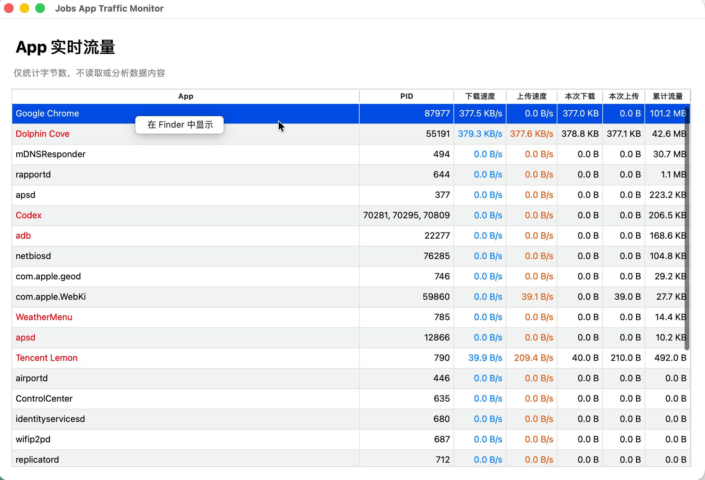

# `JobsAppTrafficMonitor`


[toc]

---

## 🔥 <font id=前言>前言</font>

JobsAppTrafficMonitor 是 macOS / Windows 按 App 实时统计上下行流量的桌面工具。程序只读取连接元数据与字节计数，不读取、解析或保存数据包内容。



## 一、目录结构 <a href="#前言" style="font-size:17px; color:green;"><b>🔼</b></a> <a href="#🔚" style="font-size:17px; color:green;"><b>🔽</b></a>

```text
.
├── README.md
├── 【MacOS】📦生成dmg.command
├── 【Windows】📦生成exe.bat
└── JobsAppTrafficMonitor/
    ├── pyproject.toml
    ├── icon.png
    ├── assets/
    ├── scripts/
    │   └── artifact_shortcuts.py
    ├── src/
    │   └── jobs_app_traffic_monitor/
    └── tests/
```

- `./README.md`：外层总说明，统一解释 Python 工程、macOS 入口和 Windows 入口。
- `./【MacOS】📦生成dmg.command`：macOS 打包入口，双击后生成 `.app` 和 `.dmg`。
- `./【Windows】📦生成exe.bat`：Windows 打包入口，在 Windows 本机生成 `.exe`。
- `./JobsAppTrafficMonitor/`：内层 Python 工程目录，保存源码、测试、配置、资源和构建辅助脚本。

外层 `.bat` / `.command` 不再使用同名文件夹包裹，也不再分别放独立 `README.md`；入口说明统一收口在本文件。

## 二、当前能力 <a href="#前言" style="font-size:17px; color:green;"><b>🔼</b></a> <a href="#🔚" style="font-size:17px; color:green;"><b>🔽</b></a>

- macOS 使用系统自带 `nettop` 获取每个进程的累计接收/发送字节数。
- 自动计算采样字节数、实时上传/下载速度和累计流量。
- 将 App 内的 Helper / XPC 进程归并到所属 `.app`。
- 外源 App 名称标红，系统 App 与系统进程使用默认颜色。
- App 行支持右键“在 Finder 中显示”。
- 提供 [**PySide6**](https://doc.qt.io/qtforpython-6/) 桌面界面。
- macOS 点击黄色最小化按钮后隐藏主窗口并驻留系统顶部菜单栏；点击图标可恢复，菜单可退出并停止采集器。
- Windows ETW 采集器接口已经预留。

## 三、打包入口 <a href="#前言" style="font-size:17px; color:green;"><b>🔼</b></a> <a href="#🔚" style="font-size:17px; color:green;"><b>🔽</b></a>

JobsAppTrafficMonitor 不提供外层源码运行入口；用户运行程序时，应先通过对应平台脚本生成 `.dmg` 或 `.exe`，再从打包产物启动。

### [【MacOS】📦生成dmg.command](./【MacOS】📦生成dmg.command)

> **目的：** 生成按 App 流量监控工具的 macOS APP / DMG。

* 阅读自述并回车，检查 Homebrew、Python 3.11+ 和 macOS 构建工具。
* 准备项目虚拟环境与 Qt / 打包依赖。
  * 必需依赖缺失：回车安装，任意非空输入取消；安装或复检失败时停止。
* 清理本工具外层旧 `dist/`，构建 APP，核验 Qt 平台插件并执行本地临时签名。
* 在构建时间目录中封装 DMG，更新快捷方式，打开产物目录并启动 APP；日志位于系统临时目录。


双击外层脚本：

```text
./【MacOS】📦生成dmg.command
```

脚本自动补齐构建环境，通过 [**PyInstaller**](https://pyinstaller.org/) 生成 `.app`，再封装为自包含 `.dmg`。构建结束后 Finder 自动定位安装包。脚本执行本机临时签名，不包含 Apple Developer ID 和苹果公证。

运行前脚本会打印内置自述并等待回车确认；确认前不会安装依赖或生成构建产物。日志写入系统临时目录中的 `【MacOS】📦生成dmg.log`。

### [【Windows】📦生成exe.bat](./【Windows】📦生成exe.bat)

> **目的：** 在 Windows 本机生成按 App 流量监控工具的独立 EXE。

* 阅读说明后继续，查找 `py -3` 或 `python`。
  * Python 缺失：确认后通过 winget 安装；winget 不可用或安装失败时停止。
* 创建或复用构建虚拟环境，检查 PySide6 与 PyInstaller。
  * 依赖缺失：回车安装，任意非空输入取消；安装后复检。
* 清理外层旧 `dist/`，在构建时间目录生成并核验单文件 EXE。
* 更新快捷方式，打开产物目录并启动本次 EXE；失败时保留终端错误。


把完整项目放到 Windows 电脑，双击外层脚本：

```text
./【Windows】📦生成exe.bat
```

脚本自动检查 Python，创建内部构建环境并生成自包含 `.exe`。Windows 安装包必须在 Windows 上构建，macOS 不负责交叉生成 EXE。

Windows 脚本会暂停展示内置说明，继续后可能通过 `winget` 安装 Python，并从 PyPI 下载 PySide6 与 PyInstaller。未进行 Windows 代码签名，SmartScreen 可能提示未知发布者。

## 四、成品运行环境 <a href="#前言" style="font-size:17px; color:green;"><b>🔼</b></a> <a href="#🔚" style="font-size:17px; color:green;"><b>🔽</b></a>

由构建脚本生成的 `.dmg/.exe` 已包含 Python、PySide6 和项目代码。普通用户运行成品时：

- 不需要安装 Homebrew。
- 不需要安装 Python。
- 不需要安装 PySide6。
- 不会修改用户的开发环境。

环境体检与自动安装只发生在构建脚本中。

## 五、输出目录 <a href="#前言" style="font-size:17px; color:green;"><b>🔼</b></a> <a href="#🔚" style="font-size:17px; color:green;"><b>🔽</b></a>

| 平台 | 输出位置 |
| --- | --- |
| macOS App | `./dist/YYYY.MM.DD HH-mm-ss/JobsAppTrafficMonitor.app` |
| macOS DMG | `./dist/YYYY.MM.DD HH-mm-ss/JobsAppTrafficMonitor-版本号-macOS-架构.dmg` |
| Windows EXE | `./dist/YYYY.MM.DD HH-mm-ss/JobsAppTrafficMonitor.exe` |

## 六、平台边界 <a href="#前言" style="font-size:17px; color:green;"><b>🔼</b></a> <a href="#🔚" style="font-size:17px; color:green;"><b>🔽</b></a>

- macOS 版本已经具备按 App 实时统计能力。
- Windows ETW 采集器仍处于接口阶段，当前 Windows 构建入口用于准备打包链路，不作为正式监控版本分发。
- VPN、代理进程可能隐藏内部转发流量的原始 App 身份。
- macOS 构建脚本只执行本机临时签名，没有 Apple Developer ID 和苹果公证。
- Windows EXE 没有代码签名，SmartScreen 可能提示未知发布者。

打包前会清理该应用工程的旧 `dist` 产物，清理失败则停止；成功后自动打开当前平台产物的磁盘位置并运行本次生成的 APP / EXE，结尾无需回车。失败时不启动软件；运行前的防误触确认保留。

必需依赖缺失时，直接回车联网安装；输入任意字符后回车取消整个流程。安装失败或复检仍不可用时停止，不继续清理旧产物或打包。健康依赖直接复用；可选升级和词库更新仍为回车跳过、任意字符执行。

第一层交付目录与平台打包脚本同层保存 `dist/`，以及最新 APP / DMG 的相对符号链接（Mac）或 EXE / 分发包的 `.lnk`（Windows）。双击快捷方式即可接触成品，真实文件保留在 `dist/`；成功构建自动更新入口，清理旧产物时移除对应旧入口。尚无成品时不生成无效快捷方式。

构建产物使用本机本地构建时间，格式为 `YYYY.MM.DD HH-mm-ss`（年月日时分秒），例如 `2020.06.04 12-23-21`。每次构建的 APP、DMG、EXE、ZIP 和配套文件统一保存到交付层 `./dist/YYYY.MM.DD HH-mm-ss/`，同次构建只取一次时间；第一层快捷方式指向本次时间目录，成功后打开该目录并启动其中的软件。旧产物沿用原有清理规则；历史产物缺少可靠构建时间时，不补写推测时间。


## 七、Mac Python 环境自检 <a href="#前言" style="font-size:17px; color:green;"><b>🔼</b></a> <a href="#🔚" style="font-size:17px; color:green;"><b>🔽</b></a>

实际使用 Python 的 Mac 入口通过脚本内部的具名函数执行环境自检，完整自检实现随该脚本携带。先阅读自述并确认，再自检 [**Homebrew**](https://brew.sh/)：已有安装执行 `brew update`，只更新自身和配方索引，不全量升级其它软件；缺少时安装并复检。安装路径精确输入 `YES` 选择系统标准目录，其它输入或回车选择用户目录；失败停止，不自动改换路线。新系统缺少 Command Line Tools 时按系统提示完成安装后重试。

[**Python**](https://www.python.org) 使用 Homebrew 配方；实际版本和标准库满足工具要求时复用，不兼容时才安装 / 升级并复检。必需修复直接回车执行，任意非空输入（含空格）、EOF 或非交互缺失环境均停止。旧虚拟环境不兼容时完整改名备份后重建，保留备份。Homebrew 安装路径选择、更新、Python 版本与健康检查均封装在实际执行脚本内部，不依赖外部环境支持库、同步脚本或父仓文件。Windows 入口保持原有平台环境流程；运行已打包成品无需准备构建环境。

## 八、<span id="repository-layout-and-entrypoints">本仓目录与脚本入口</span> <a href="#前言" style="font-size:17px; color:green;"><b>🔼</b></a> <a href="#🔚" style="font-size:17px; color:green;"><b>🔽</b></a>

以下为当前检出的源码与维护入口；依赖环境、Git 元数据、构建缓存和生成产物略去，独立子仓仅列目录。

```text
.
├── .gitignore
├── 【MacOS】📦生成dmg.command
├── 【Windows】📦生成exe.bat
├── JobsAppTrafficMonitor/
│   ├── assets/
│   ├── icon.png
│   ├── pyproject.toml
│   ├── scripts/
│   ├── src/
│   └── tests/
└── README.md
```

* `JobsAppTrafficMonitor/src/` 保存采集器与桌面界面；`scripts/` 保存产物快捷方式辅助代码，`tests/` 保存回归用例。

<a id="🔚" href="#前言" style="font-size:17px; color:green; font-weight:bold;">我是有底线的➤点我回到首页</a>
